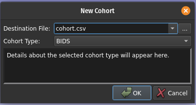
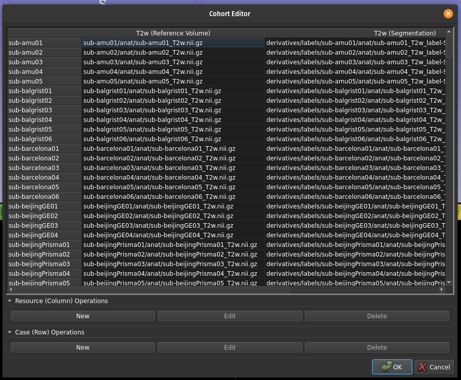
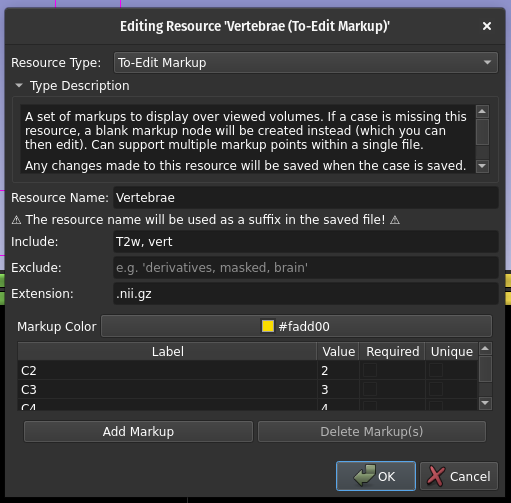

# Case Annotation and Review Tool (CART)

# What is CART?

CART is a module for 3D Slicer designed to help implement, manage, and run iterative analyses on image datasets. You can think of CART as an assembly line for data analysis; you define how your data should be grouped (the "Cases"), what should be loaded for you (the "Resources"), and what process you want to apply to it (the "Task"), and CART will manage the rest for you! Most tasks will even track how many you've completed, ensuring that you don't repeat the same case twice (or skip over one by mistake), even after rebooting Slicer.

Currently, it provides the following capabilities:

* Managing sequential cases (be they patients, sub-studies, or other collections of data)
* Automatic caching and memory management (including recent case caching)
* Defining and handling multiple jobs, which can be run independently of one another
* Several common tasks out-of-the-box, including:
  * Segmentation Review, Creation, and Correction
  * Markup Management and Review
  * Case Classification and Modification

Developers can also extend its capabilities further, creating custom tasks (with their own custom UI elements) that still hook into CART's case-based iteration and memory management utilities!

# Basic Usage

* [Installation]()
* [Getting Started]()
* [Running a Job]()
* FAQs (WIP)

# Detailed Usage Guides

WIP

# Developer Documentation

WIP

# Contributors

Original idea and first version of code from Dr. Laurent Létourneau-Guillon and his team in ICH_SEGMENTER_V2, SlicerCART, and Brain_Extraction. This is an effort to create a unified code for a configurable 3D Slicer extension.

Contributors include:
- Kalum Ost
- Laurent Létourneau-Guillon
- Emmanuel Montagnon
- An Ni Wu
- Maxime Bouthillier
- Delphine Pilon
- Julien Cohen-Adad

---

**WIP; Contents below this region are being revised and should not be taken at face value!** 

---

## Cohorts and You

Within CART, a "cohort" dictates how CART's various tasks will iterate through the data specified within a job. It's stored as a `.csv` file, with each row indicating one "case" that will be run, and each column indicating a potential resource that each case could have. Given you generated the file through CART (see above), there will also be a `.json` sidecar file alongside it, providing additional metadata for CART to reference.

Being a `.csv` file, you can create these from scratch, be it manually or via a script. However, we strongly encourage you use CART's provided "Cohort Generator" and "Cohort Editor", which make cohort creation and management both much easier and less prone to error (especially with task-specific settings).

### The Cohort Generator

When you click the "New Cohort File" button during Job creation/editting, you'll be presented with the following:

The "Destination File" determines the name of the cohort file you want to create (with the desired `.csv` extension!); you can also specify the full path to a desired output destination if you'd like. Be careful; CART will happily overwrite pre-existing cohort files if you tell it too!

You can then specify the cohort's "type", which dictates how CART will initially identify and generate cases (rows) in the cohort. Select one to bring up further details; you can also select "Blank Slate" if you want to create a cohort completely from scratch (with no cases identified by default _at all_). Once you click "Ok", a new cohort `.csv` (alongside a `.json` sidecar) will be created and opened in the Cohort Editor.

### The Cohort Editor

Once you have a cohort `.csv` file (generated by CART or otherwise), you can use the Cohort Editor to extend and/or modify it:

The buttons along the bottom allow you to add or drop cases (rows) and resources (columns). If you want to edit exiting rows/columns, either right-click on the relevant cells and select the corresponding "Modify" option, or select the row/column you'd like to edit and click the corresponding "Edit" button along the bottom. In both cases, CART will try to fill in the cells of the table intelligently based on the settings of rows/columns which intersect with the modified element. 

If you need to manually enter something into the table, double-clicking on the cell will let you edit the contents directly w/o using CART's automatic updating. How this automatic updating is run is task-specific; refer to the task's specific documentation for further details.

Like the job profile itself, many tasks can also have resource-specific configuration settings. An example of what this can look like is shown below, taken from the "Markup" task:

---

# For Developers:

## Project Standards

Below is a short summary of standards and format we use in CART; for more details, please refer to the [WIP!] [developer wiki](https://github.com/SomeoneInParticular/CART/wiki).

### Python

We follow [PEP8](https://peps.python.org/pep-0008/) standards with two notable exceptions:

* GUI code which directly utilizes or references C++ code (via QT) should use `lowerCamelCase` for functions, rather than the standard `lower_snake_case` used by Python, to help distinguish it from "pure" Python code.
* Line length is capped at 88 characters per line, rather than 79; this is derived from our linter (Black). You can read the justification [here](https://black.readthedocs.io/en/stable/the_black_code_style/current_style.html#line-length)

## IDE Set Up

### Source Directories

As both Slicer and CART load libraries into Python's path post-init, most IDEs will not be able to recognize some of the import statements used by our codebase by default.

To fix this, please mark the following directories as "source" folders in the Project's structure:

* `{Slicer Installation Directory}/bin/Python`: exposes that installations versions of VTK, CTK, and QT, along with slicer's own utilities.
* `{This Directory}/CART`; exposes CARTLib and its contents.

## Example Data

⚠️ This will be changed soon, replaced with a `git-annex` dataset to slim up the repository! ⚠️

The example data consists of a subset (fold0) from the PI-CAI dataset, featuring prostate MRI images and their corresponding segmentations. The original data can be obtained from the [official website](https://zenodo.org/records/6624726) by downloading the `picai_public_images_fold0.zip` file.

For this project, the first four subjects were selected and the images were converted from MHA to NRRD format.

1. Example `sample_data` is adapted from this original data and is located under `sample_data.zip`.
2. Unzip the file to a folder of your choice.

