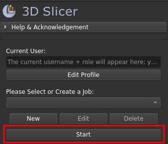
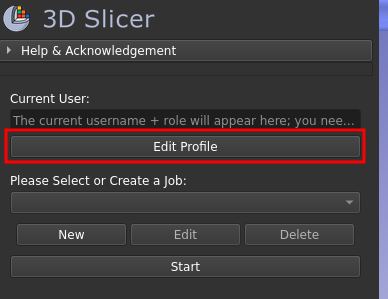
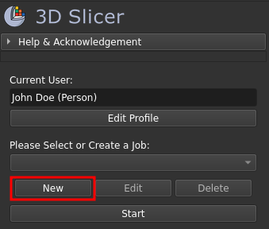
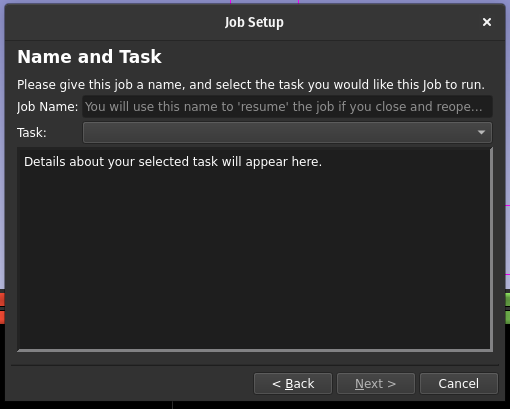
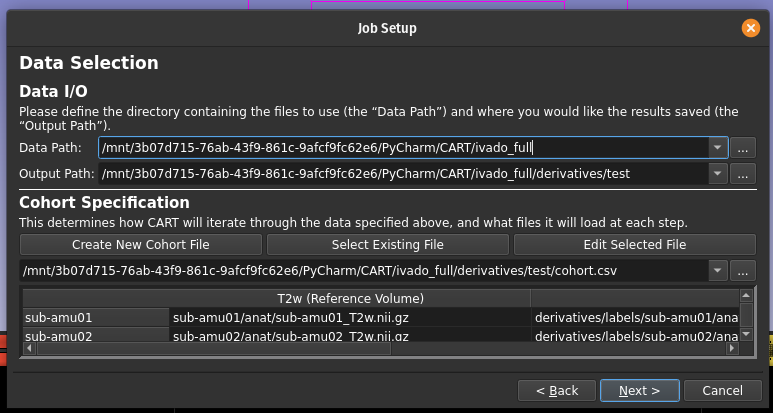
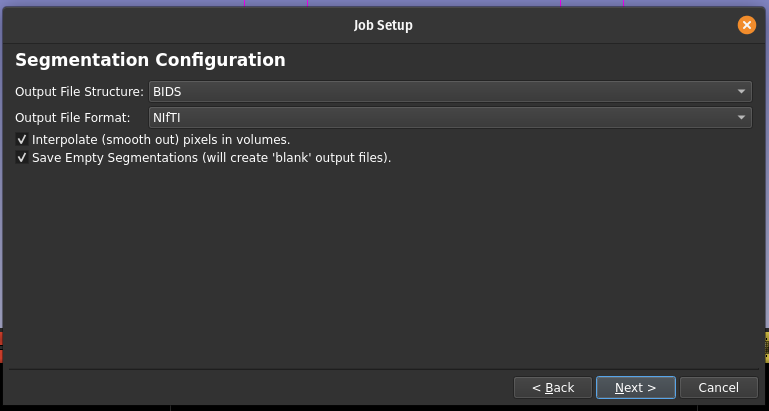
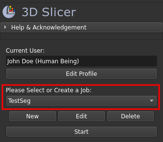

# Case Annotation and Review Tool (CART)


## Table of Contents

* [What is CART?](#what-is-cart)
* [For Users](#for-users)
  * [Setting up CART](#setting-up-cart)
  * [Getting Started](#getting-started)
  * [Starting a Task](#starting-a-task)
* [For Developers](#for-developers)
  * [Project Standards](#project-standards)
  * [IDE Set Up](#ide-set-up)
  * [Example Data](#example-data)

---

# What is CART?

CART is a module for 3D Slicer designed to help implement, manage, and run iterative analyses on image datasets. You can think of CART as an assembly line for data analysis; you define how your data should be grouped ("cases"), what should be loaded for you ("resources"), and what process you want to apply to it ("tasks"), and CART will manage the rest for you! Most tasks will even track how many you've completed, ensuring that you don't repeat the same case twice (or skip over one by mistake).

Currently, it provides the following capabilities:

* Managing sequential cases (be they patients, sub-studies, or other collections of data).
* Caching and memory management.
* Defining and handling multiple jobs, which can be run independently of one another.
* Custom task creation and registration [Latter currently done via Config file manipulation].

A number of features are currently in progress as well:

* Case pre-fetching/deferred loading.

---


# For Users

## Installing CART

### Prerequisites

- Slicer v5.8 (other versions may work, without guarantee)

### Obtaining the Files

#### Option 1 (preferred): Download stable release

- Download the ZIP archive for the [latest release](https://github.com/neuropoly/slicer-cart/releases/latest).
- Unpack said ZIP archive to where you would like CART to live (on most OS systems, double-clicking on the file should tell you how to do this)

#### Option 2: Download Current Dev Build

- Download the git repository as a ZIP archive from [here](https://github.com/SomeoneInParticular/CART/archive/refs/heads/main.zip)
- Unpack said ZIP archive to where you would like CART to live (on most OS systems, double-clicking on the file should tell you how to do this)

#### Option 3: Clone a Specific Branch from GitHub

For this, you need to have `git` installed. 

- Open a terminal and navigate to the directory you'd like CART to live in.
- Run the following command to clone the current `CART` repository, replacing `CART-main` with :
  ~~~
  git clone git@github.com:SomeoneInParticular/CART.git CART-main
  ~~~

### Registering CART in Slicer

- Open a file browser window and navigate to the downloaded `slicer-cart/` directory. Then, navigate to the `CART` subdirectory, which should contain a `CART.py` file.
- Start up Slicer.
- Go to `Edit` > `Application Settings`


- In the "settings" popup, select `Modules` from the left sidebar


- Click and drag `CART.py` from the file browser into the "Additional module paths" panel.
- Click "OK"; Slicer should prompt you that it needs to restart. Say "Yes".

### [Optional] Setting CART as your Default Module

- Start Slicer
- Go to `Edit` > `Application Settings`
- In the "settings" popup, select `Modules` from the left sidebar
- Under "Default startup module", Select `Utilities` > `CART`


## Getting Started

CART has a built-in wizard to walk you through initial set up; once you've installed CART, just click "Start" and follow its instructions!



Alternatively, you can follow the subsections below one at a time; both will help you set up CART to run, this document just provides more details on the intent and purpose of each step of the process.

### Creating Your Profile

The user profile allows CART to track your name and (optionally) position. How CART uses this depends on the task, with many tasks using this to log who ran a given job or keep separate outputs on a per-user basis. CART requires you provide a name to function, however, and cannot run any jobs until you do so.

If you've just installed CART, you can click the "Edit Profile" button to fill in these credentials:



Fill in your name and (optionally) a position and confirm, and done! Your profile is now complete. You can edit it later by clicking the same button too, so no worries if you made a mistake or need to update it later.

### Job Creation

CART, much like a forman managing an assembly line, needs to have a method to tell the workers of the assembly line (3D Slicer) what they need to do. This includes what Slicer should expect to see (the "Cohort"), what it should do with it (the "Task"), and where to put results once they're done (the "Output"). Taken together, these form a "Job" for CART to reside over, and much like the forman, the boss (you) is the one that decides what the assembly line needs to be making.

To make this easier, CART provides a Job Setup wizard to walk you through this process; just click the "New" button to bring it up, and follow its instructions. Don't worry if you make a mistake as well; you can edit (or delete) CART job's after they've been generated.



#### Name and Task

Here you provide the job's name and decide what it should do (its "Task").

A job's name can be anything, so long as it isn't already used by another job registered in CART.

Selecting a task from the dropdown will bring up details on what it is designed to do and how it will do it; give it a skim to confirm it's what you'd like to do before proceeding.



In the future, you will be able to register and use custom tasks as well; this is still in development, however.

#### Data Selection

Here you define what files the job should use, where it should save its results, and how that data should be iterated via a "cohort" file. To select the former two, click the '...' to bring up the file browser to choose their respective folders.



Assuming you've never used CART before, you'll probably not have a cohort file ready. If so, click the "Create New Cohort File" button; this will walk you through the process of creating one using the contents of the input folder you provided and the task you selected previously. If you have a cohort file already, however, you can just select it via the same '...' button described prior, or by selecting the "Select Existing File" button.

Once a file has been selected/created, a preview of its contents will be shown in the window at the bottom the panel. If you wish to edit its contents, select the "Edit Selected File" button to do so.

#### Task-Specific Options

As the name implies, what appears here depends on the task you selected previously. An example of options the Segmentation task provides is shown below: 


The contents of this are normally related to how files will be loaded into Slicer when a new case is started, or how the results of the task will be saved (ex. file format). Most tasks have sensible defaults for any configurations presented here, but you should skim through these options to be sure.

## Running a Job

Once you've created your profile and created at least one job, select it from the dropdown highlighted below:



The "Start" button will now have CART start the job; enjoy!

### Opening a Cohort from the Command Line

You (or another tool) can also open CART straight onto a cohort file from the command line, skipping job creation:

```bash
Slicer --python-code "import CART; CART.open_cohort(r'/path/to/cohort.csv', 'Segmentation', r'/path/to/derivatives/labels')"
```

The three arguments are the cohort file, the task to run (`Segmentation`, `Markup`, or `Classification`), and the folder to save results to. The first time, CART creates a job named after the cohort file (pass `name='...'` to choose your own); running the same command again re-uses that job, along with your progress. CART must already be registered in Slicer (see [Registering CART in Slicer](#registering-cart-in-slicer)).

## Cohorts and You

Within CART, a "cohort" dictates how CART's various tasks will iterate through the data specified within a job. It's stored as a `.csv` file, with each row indicating one "case" that will be run, and each column indicating a potential resource that each case could have. Given you generated the file through CART (see above), there will also be a `.json` sidecar file alongside it, providing additional metadata for CART to reference.

Being a `.csv` file, you can create these from scratch, be it manually or via a script. However, we strongly encourage you use CART's provided "Cohort Generator" and "Cohort Editor", which make cohort creation and management both much easier and less prone to error (especially with task-specific settings).

### The Cohort Generator

When you click the "New Cohort File" button during Job creation/editting, you'll be presented with the following:


The "Destination File" determines the name of the cohort file you want to create (with the desired `.csv` extension!); you can also specify the full path to a desired output destination if you'd like. Be careful; CART will happily overwrite pre-existing cohort files if you tell it too!

You can then specify the cohort's "type", which dictates how CART will initially identify and generate cases (rows) in the cohort. Select one to bring up further details; you can also select "Blank Slate" if you want to create a cohort completely from scratch (with no cases identified by default _at all_). Once you click "Ok", a new cohort `.csv` (alongside a `.json` sidecar) will be created and opened in the Cohort Editor.

### The Cohort Editor

Once you have a cohort `.csv` file (generated by CART or otherwise), you can use the Cohort Editor to extend and/or modify it:


The buttons along the bottom allow you to add or drop cases (rows) and resources (columns). If you want to edit exiting rows/columns, either right-click on the relevant cells and select the corresponding "Modify" option, or select the row/column you'd like to edit and click the corresponding "Edit" button along the bottom. In both cases, CART will try to fill in the cells of the table intelligently based on the settings of rows/columns which intersect with the modified element. 

If you need to manually enter something into the table, double-clicking on the cell will let you edit the contents directly w/o using CART's automatic updating. How this automatic updating is run is task-specific; refer to the task's specific documentation for further details.

Like the job profile itself, many tasks can also have resource-specific configuration settings. An example of what this can look like is shown below, taken from the "Markup" task:


## Correcting SCT Outputs with CART

You can use CART instead of [manual-correction](https://github.com/spinalcordtoolbox/manual-correction) to fix segmentations and labels from the [Spinal Cord Toolbox (SCT)](https://spinalcordtoolbox.com).

### 1. Make a Cohort File

Make a `.csv` file with one row per subject. SCT can make it for you (see [spinalcordtoolbox#5091](https://github.com/spinalcordtoolbox/spinalcordtoolbox/issues/5091)), or you can write it yourself:

```csv
uid,T2w_volume_reference,seg-manual_segmentation_editable,labels-disc-manual_markup_editable
sub-01,/data/sub-01/anat/sub-01_T2w.nii.gz,/sct/sub-01_T2w_seg.nii.gz,/sct/sub-01_T2w_labels-disc.nii.gz
sub-02__ses-01,/data/sub-02/ses-01/anat/sub-02_ses-01_T2w.nii.gz,/sct/sub-02_ses-01_T2w_seg.nii.gz,/sct/sub-02_ses-01_T2w_labels-disc.nii.gz
```

* `uid` is the subject. If there is a session, write `sub-XX__ses-YY` (two underscores).
* Put the image in a column ending with `_volume_reference`.
* Put segmentations in columns ending with `_segmentation_editable`, and disc labels in columns ending with `_markup_editable`.
* The first part of the column name (like `seg-manual`) goes at the end of the saved file name.
* The files can be in any folder. You don't need a `.json` file next to the `.csv`.

### 2. Open it in CART

```bash
Slicer --python-code "import CART; CART.open_cohort(r'/path/to/cohort.csv', 'Segmentation', r'/path/to/dataset/derivatives/labels')"
```

Use `'Segmentation'` for segmentations and `'Markup'` for disc labels. The first time, CART asks you to make a profile. Your name is saved with each correction.

### 3. Fix Each Subject

* **Segmentations**: pick the segmentation in CART's panel and fix it with the tools under it.
* **Disc labels**: drag a label to move it. Right-click it to delete it. To add a missing disc, place a new point and rename it to the disc number (like `6`) in Slicer's Markups module. CART saves that number in the file.

Press `Alt+D` to save and go to the next subject. Press `Alt+S` to only save.

### 4. Find the Results

Your corrections are saved in the output folder, in BIDS format. Each one comes with a `.json` file with your name and the date:

```
derivatives/labels/sub-01/anat/sub-01_T2w_seg-manual.nii.gz
derivatives/labels/sub-01/anat/sub-01_T2w_seg-manual.json
```

The files keep the same orientation as the original image. Disc labels keep their numbers. Your SCT files are never changed.

---

# For Developers:

## Project Standards

Below is a short summary of standards and format we use in CART; for more details, please refer to the [WIP!] [developer wiki](https://github.com/SomeoneInParticular/CART/wiki).

### Python

We follow [PEP8](https://peps.python.org/pep-0008/) standards with two notable exceptions:

* GUI code which directly utilizes or references C++ code (via QT) should use `lowerCamelCase` for functions, rather than the standard `lower_snake_case` used by Python, to help distinguish it from "pure" Python code.
* Line length is capped at 88 characters per line, rather than 79; this is derived from our linter (Black). You can read the justification [here](https://black.readthedocs.io/en/stable/the_black_code_style/current_style.html#line-length)

## IDE Set Up

### Source Directories

As both Slicer and CART load libraries into Python's path post-init, most IDEs will not be able to recognize some of the import statements used by our codebase by default.

To fix this, please mark the following directories as "source" folders in the Project's structure:

* `{Slicer Installation Directory}/bin/Python`: exposes that installations versions of VTK, CTK, and QT, along with slicer's own utilities.
* `{This Directory}/CART`; exposes CARTLib and its contents.

## Example Data

⚠️ This will be changed soon, replaced with a `git-annex` dataset to slim up the repository! ⚠️

The example data consists of a subset (fold0) from the PI-CAI dataset, featuring prostate MRI images and their corresponding segmentations. The original data can be obtained from the [official website](https://zenodo.org/records/6624726) by downloading the `picai_public_images_fold0.zip` file.

For this project, the first four subjects were selected and the images were converted from MHA to NRRD format.

1. Example `sample_data` is adapted from this original data and is located under `sample_data.zip`.
2. Unzip the file to a folder of your choice.

# Contributors

Original idea and first version of code from Dr. Laurent Létourneau-Guillon and his team in ICH_SEGMENTER_V2, SlicerCART, and Brain_Extraction. This is an effort to create a unified code for a configurable 3D Slicer extension.

Contributors include:
- Kalum Ost
- Laurent Létourneau-Guillon
- Emmanuel Montagnon
- An Ni Wu
- Maxime Bouthillier
- Delphine Pilon
- Julien Cohen-Adad
