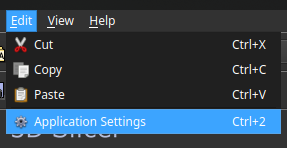
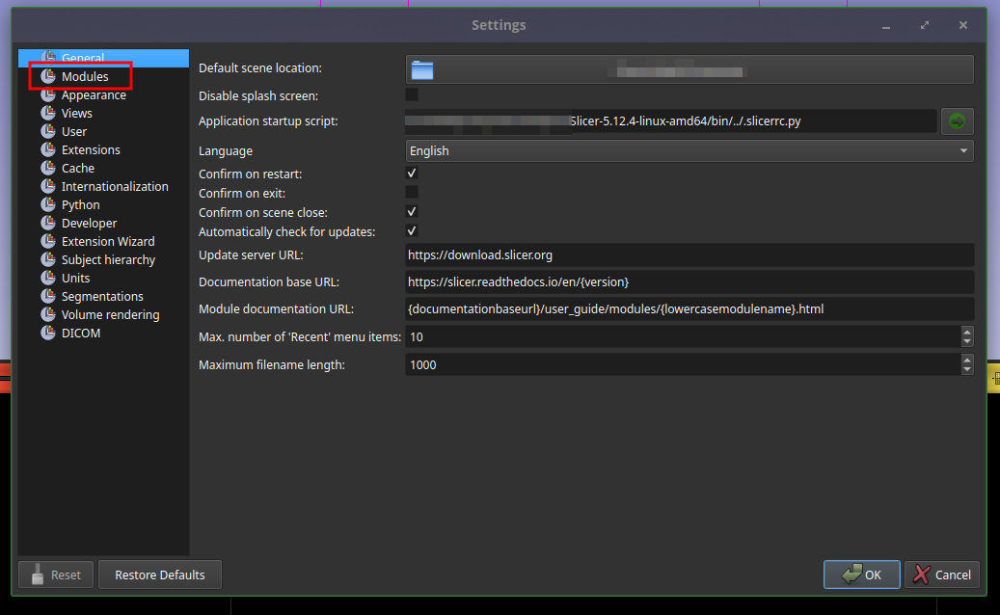
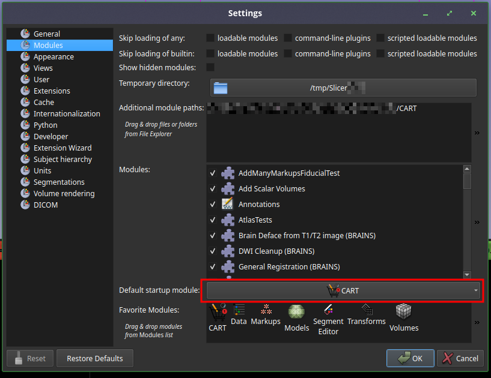

# Getting Started

## Prerequisites
* Have a working installation of Slicer v5.8 or newer (tested up to v5.12)
* A copy of CART that has been [installed in Slicer](./installation.md). 

## Initializing CART

WIP

### Setting CART as your Default Module

If you are only using Slicer with CART, following these instructions will ensure that Slicer automatically starts CART when initially booted, skipping the 

1. Start Slicer
2. Go to `Edit` > `Application Settings`

3. In the "settings" popup, select `Modules` from the left sidebar

4. Under "Default startup module", Select `Utilities` > `CART`. Confirm with "Ok".

