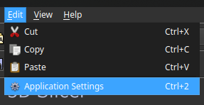
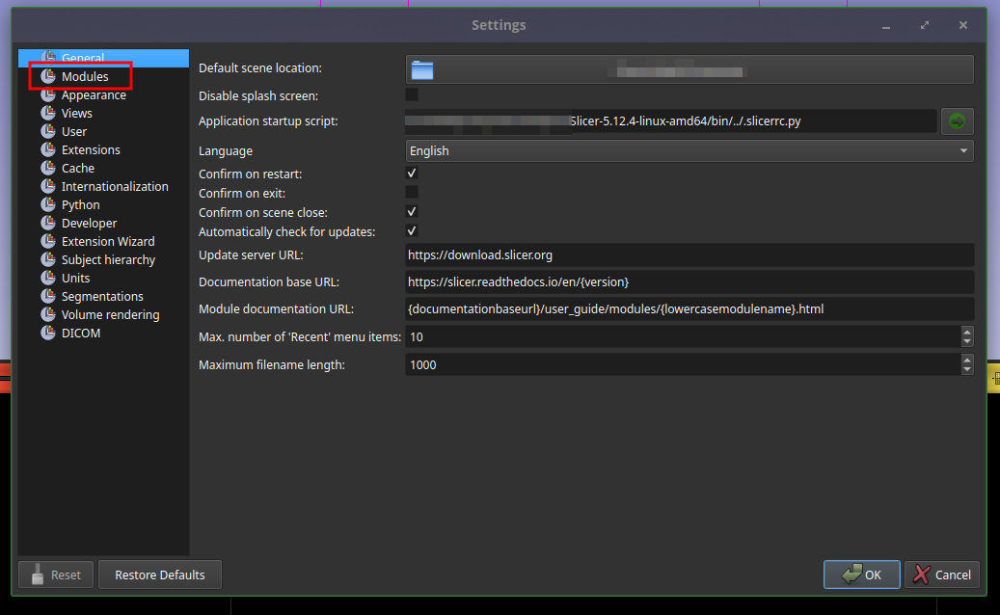
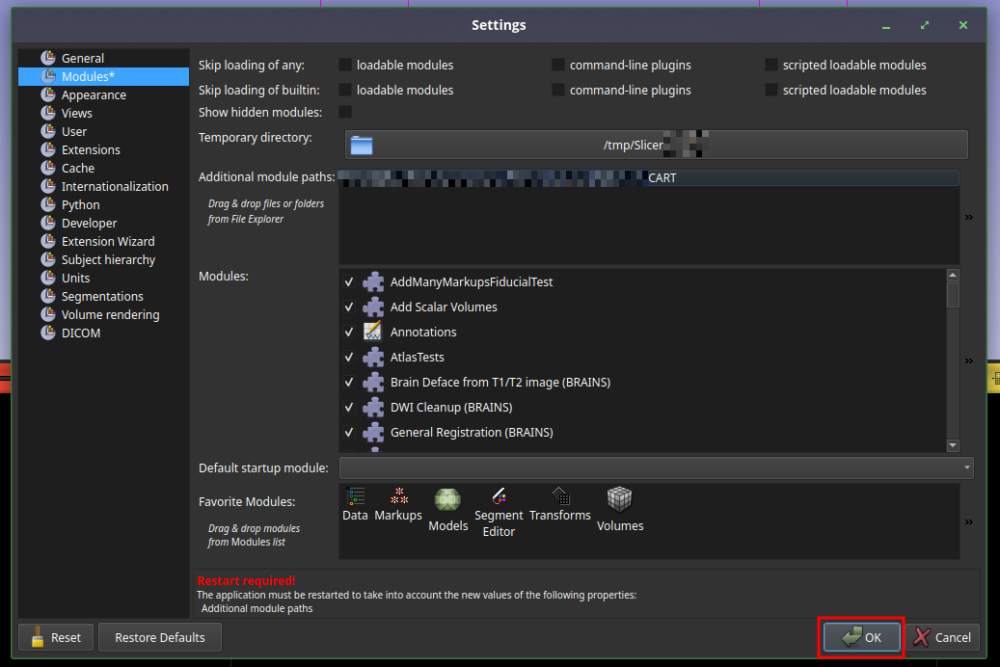
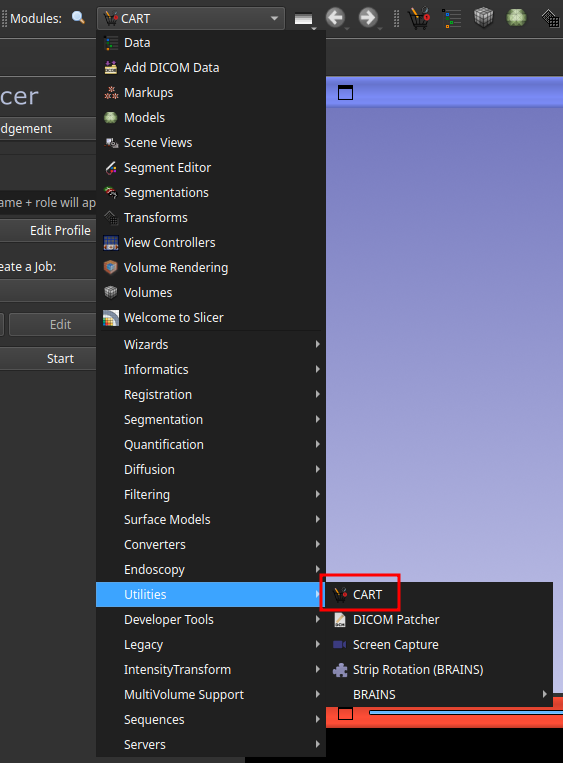

# Installing CART

## Prerequisites

Please ensure you have downloaded the following for your specific operating system before beginning:

- 3D Slicer version 5.8 or above (tested up to version 5.12):
  - Download the latest version [here](https://download.slicer.org/).
- A copy of CART:
  - Recommended: the [latest release](https://github.com/neuropoly/slicer-cart/releases/latest).
  - Cutting Edge: the [developer ZIP archive](https://github.com/neuropoly/slicer-cart/archive/refs/heads/main.zip)

Both should be unzipped in a place you can easily find.

## Installing CART

1. Locate your (unzipped) CART directory, then the `CART/` directory within it. This should contain a `CART.py` file
2. Start Slicer and wait for it to finish loading
3. In Slicer, go to `Edit` > `Application Settings`: 

4. In the resulting popup, select `Modules` from the left sidebar:

5. Drag-and-drop the `CART.py` file onto to the "Additional Module Paths" panel
6. Confirm the registration by selecting "OK" on the bottom right:

7. Restart Slicer (it should prompt you to do so immediately).

CART should now appear as one of the modules available to Slicer, under the "Utilities" section:

