# Getting Started

This page acts as a tutorial, helping to familiarize yourself with CART jobs and showing how they are configured.

## Prerequisites

* Have a working installation of Slicer v5.8 or newer (tested up to v5.12)
* A copy of CART that has been [installed in Slicer](./installation.md) with a user profile.
* A copy of the example dataset (available [here]()), unzipped and in a location you know.

> If you would like a more "hands on" tutorial, you can just click "Start" at the bottom of the page; CART will walk you through each step, albeit in less detail than this tutorial.

## Introduction; What is a "Job"?

CART, much like a forman managing an assembly line, needs to tell its workers (in this case, 3D Slicer) what they are expected to do, and how. For us, this means we need to tell Slicer a few things:

  * Its **Input**: Where Slicer should look for files/data.
  * Its **Output**: Where the final result of our process should be placed.
  * Its **Cohort**: How it should iterate through its inputs (the "Cases"), as well as how each file should be loaded.
  * Its **Task**: What Slicer do to each case and how. 

In CART, these are collected together to form a "Job". Once created, the Job's settings to dictate how you will be presented each cases information, and what GUI elements are presented to you. CART provides a Job Setup wizard to walk you through this process step-by-step. We will be using it for this tutorial; just click the "New" button to begin!.

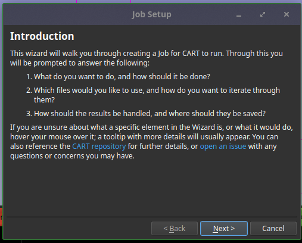

> You can always modify a Job's settings later; don't be afraid to experiment!

### Job Name and Task

After you finish reading the introduction page, click "Next" to bring up the following:

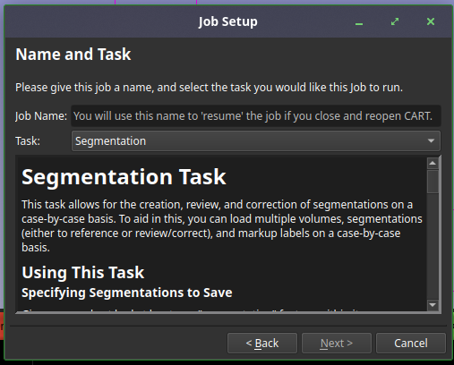

Here you can give the Job a name as well as the "Task" it will be designated to do. The name is simply a label you (and CART) will use to identify this Job in the future; you can place whatever you like here, as long as a Job you've created in the past does not already have that name. The Task, on the other hand, is more important; it will dictate what you will do for each case, and the tools presented to you for doing so. By default, CART provides three Task options:

* **Segmentation:** Allows for the review, correction, and modification of image segmentation files.
* **Markup:** The same, but for point markups (i.e. marking the positions of tumors in an image).
* **Classification:** Iterative image classification and written annotation.

Selecting a task will bring up its documentation for your review. Feel free to read through each; for this tutorial, however, we will be using the **Segmentation** Task. Once you have given the task a name and selected the "Segmentation" task, click "Next".

### Data and Output

You should now be presented with the following:

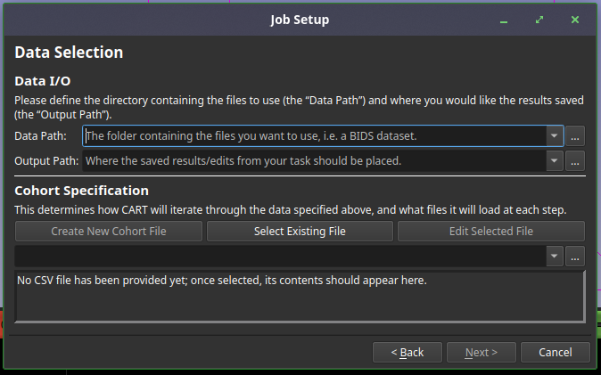

Here we will define the following:

* Where the Job should look when trying to load files (the "Data Path")
* Where this Job's outputs (if any) should be saved (the "Output Path")
* How this Job should iterate through its data (the "Cohort Specification")

For the "Data Path", click the "..." button to its right and navigate to the example dataset you downloaded prior, and confirm. Then, for the "Output Path", click its "..." and create a new directory within the "derivatives" folder called "tutorial", then confirm. Once you're done, it should look something like the following:

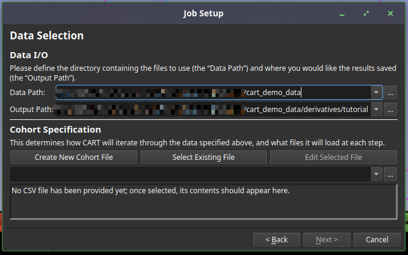

### The Cohort

The Cohort is a bit more complex; it dictates how CART will iterate through the data, and what files should be loaded for each iteration. We'll need to create one for the Job to function; click "Create New Cohort File" to begin; the following prompt should appear:

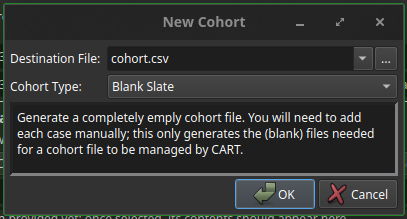

While our data is BIDS formatted, select the "Blank Slate" cohort type; this will better demonstrate how CART operates. You can leave the file name as "cohort.csv", or change it; this just determines what name the resulting cohort file will have. Then click OK to bring up the Cohort Editor:

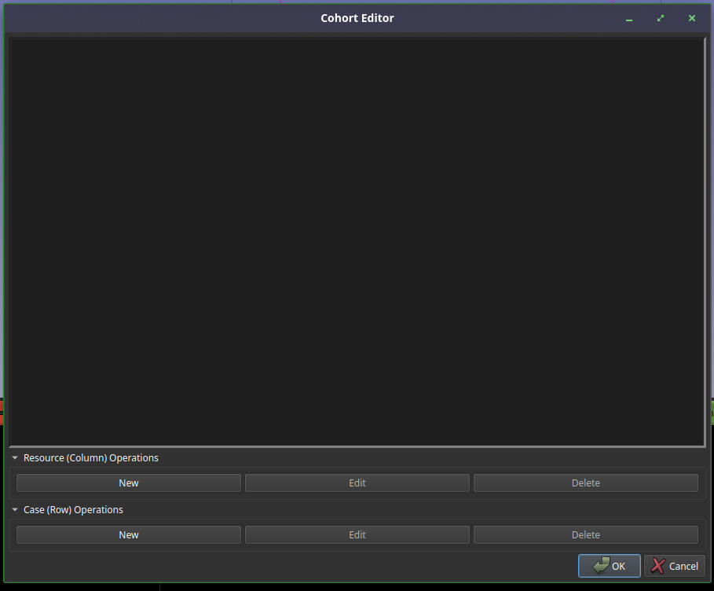

#### Managing Cases

For this tutorial, we want to iterate through each subject one by one; this makes each subject a "Case". That means we will add a row for each. To do so, click the "New" button within the "Case (Row) Operations" panel, along the bottom; the following should appear:

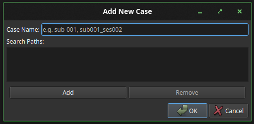

Let's begin by adding `sub-amu01`; give the case the same name (though any name that isn't already taken is valid). Then, click "Add" and select its folder, then confirm. The dialogue should now look something like this:

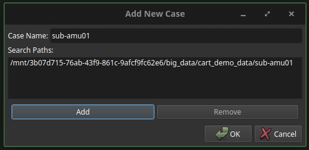

CART now knows to treat any files within that directory as being part of the `sub-amu01` (or whatever you chose to call it) case! Let's also add the corresponding derivatives file to the search paths so CART associates them with the case as well; it should be in `derivatives/labels/sub-amu01`. Once you're done, the dialogue should appear as follows:

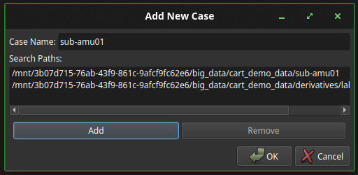

Once you've confirmed things are correct, click "OK" to confirm the changes. A new row with the same name as your case should now appear:

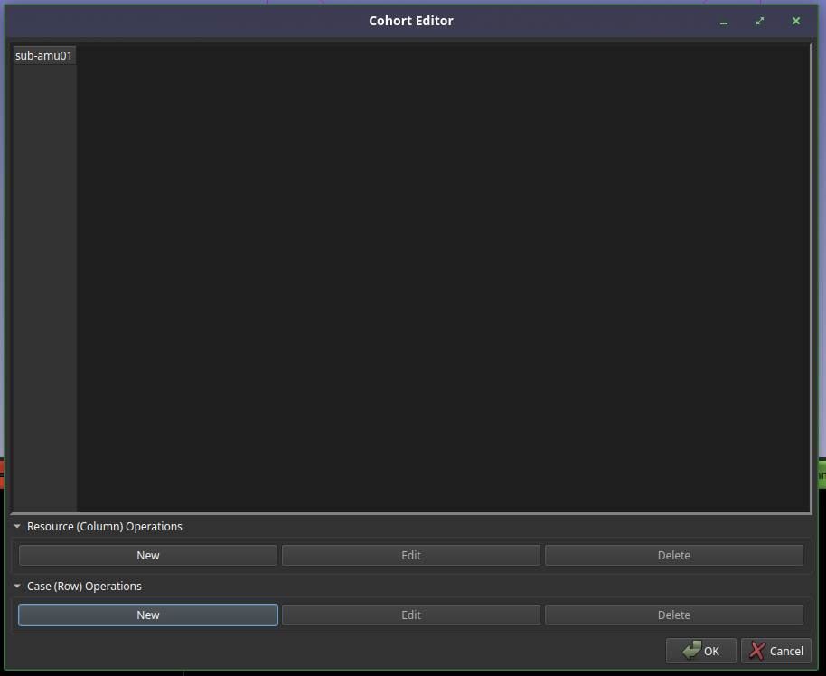

Repeat this process for the other two subjects (`sub-amu02` and `sub-amu03`); once you're done, the cohort editor should have three rows, like so:

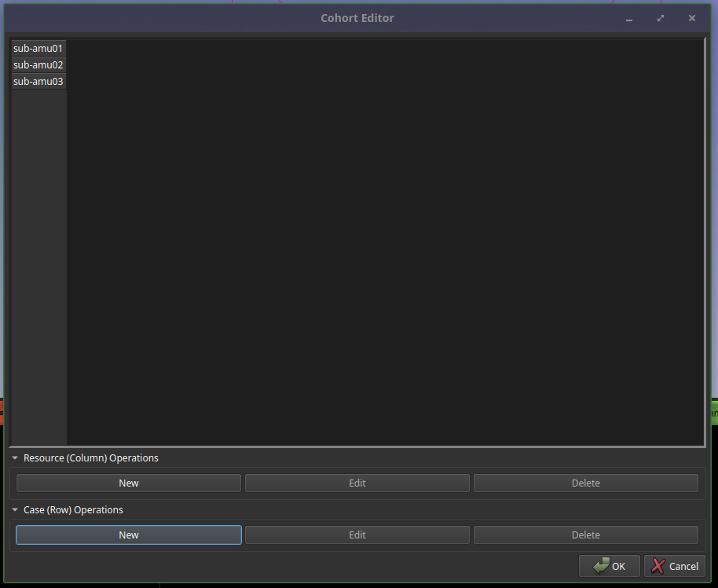

#### Managing Resources

Now to specify our resources (that is, what each case should load and present to us when initially loaded). To do so, click the "New" button, this time in the "Resource (Column) Operations" panel. You should be prompted with the following:

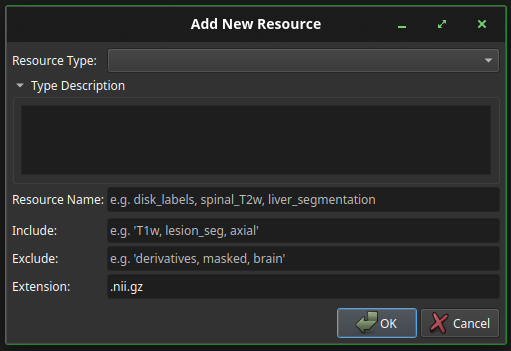

Skim through the "Resource Type" dropdown options; note how each defines a different data type, and how it will be managed. Those with an asterisk (\*) denote a resource that is _required_ for this Job; in the case of the Segmentation task, this includes the "Reference Volume" and "To-Edit Segmentation" types. Let's start with the "Reference Volume"; in most tasks, this becomes both the background volume (with markups and segmentations overlaid on top) and the reference co-ordinate system everything is mapped to. Select it, and give the resource the name "spine_ref":

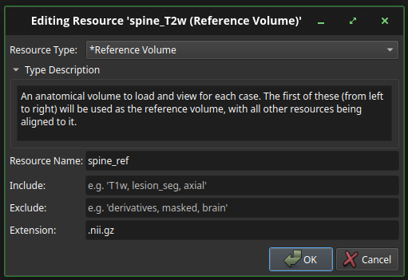

For this tutorial, we'll use the "T2-weighted" sequences for the purpose; thankfully, the corresponding files for each case contain `T2w` within them; to tell CART to select these, enter "T2w" into the "Include" field. These files are also `.nii.gz` files, so we can leave the extension untouched. Click "OK" to confirm these changes, and observe the result:

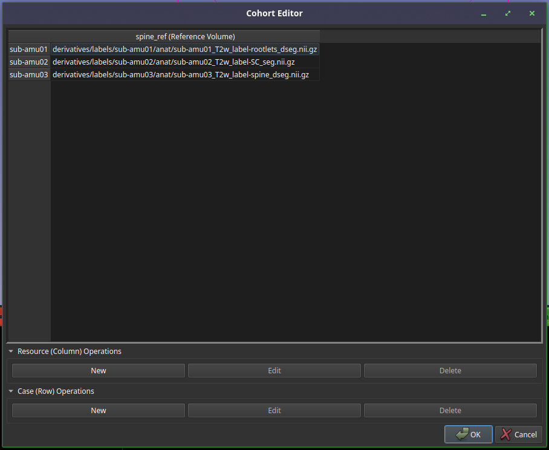

Seems we forgot to filter out the "derivatives" folder, and CART has selected various derivative files. Thankfully, we can edit pre-existing resourced to correct this; select the resource, then select the "Edit" button to bring up the same menu we had prior. Let's add "derivatives" to the exclude filter; the cohort editor should look something like this when you're done:

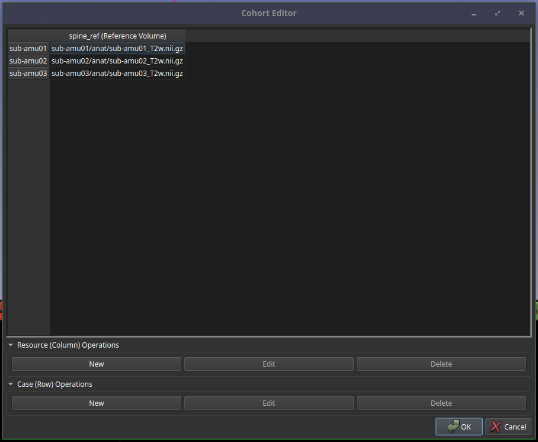

Excellent! Let's add the other required resource type now, "To-Edit Segmentation". Select the corresponding resource type, and notice how the window changes:

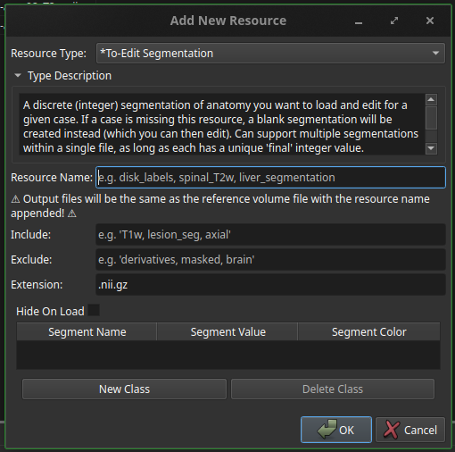

This a custom type that the Segmentation task has extended; as the warning suggests, changes made to this resource will be saved as _output_. For this tutorial, lets assume we want to use review and correct the T2w segmentations of the spinal cord (SC); as such, we'll name this resource "tutorial-corrections". The corresponding segmentation files share the same naming convention as before; each contains "T2w" and "SC" in its name, and are contained within the "labels" folder. Updating our field to represent this should show the following:

> You can separate multiple search elements with a comma (,)

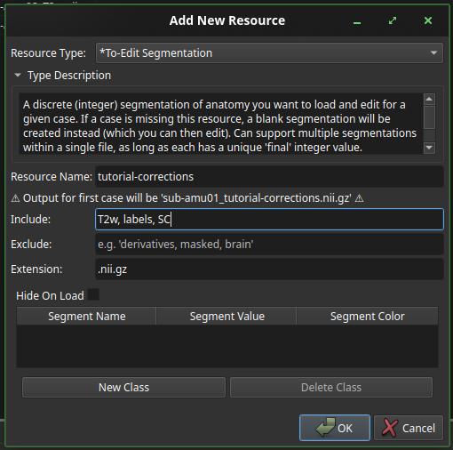

Now for the table on the bottom. Several tasks will define custom resource-specific requirements, and this is one of them; lets hold the mouse over the "New Class" button to get an idea of what it does:

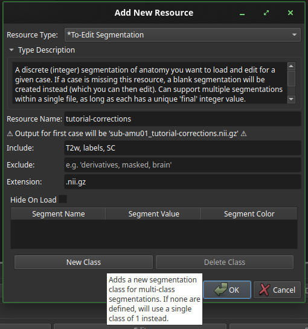

Seems that this element allows us to define what segmentations we expect to see! In the case of our data, we only have one segmentation (with a "Segment Value" of 1, representing the spinal cord); lets add it to the list. Click "New Class", then edit the values in new table entry so that the segment will be labeled "spinal cord"; make it your favourite color while you're at it (double-click the color section to change it). Once you're done, it should look something like this:

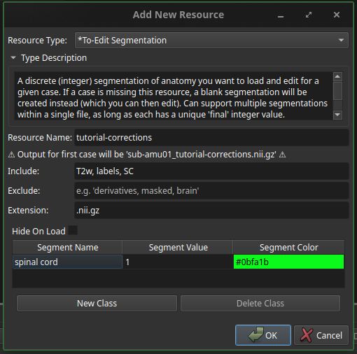

> Most tasks will have their own documentation detailing each of these features explicitly; if in doubt, check them out!

Once you're satisfied, click "OK" to confirm. A second column (which has automatically selected the corresponding files) should now appear:

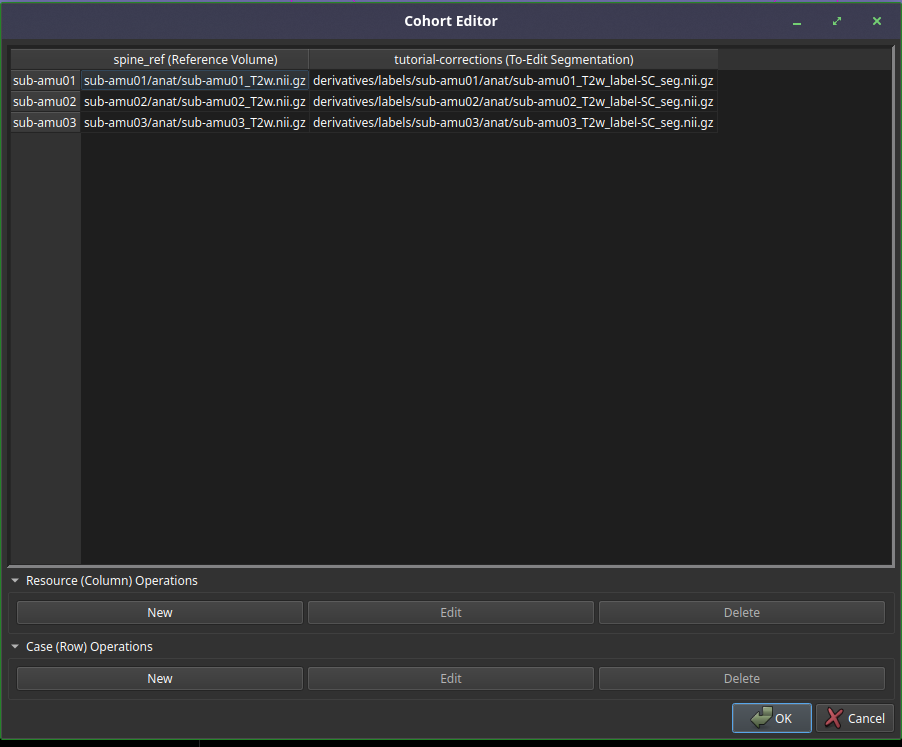

Click OK, and the cohort will save and be tracked by the job!

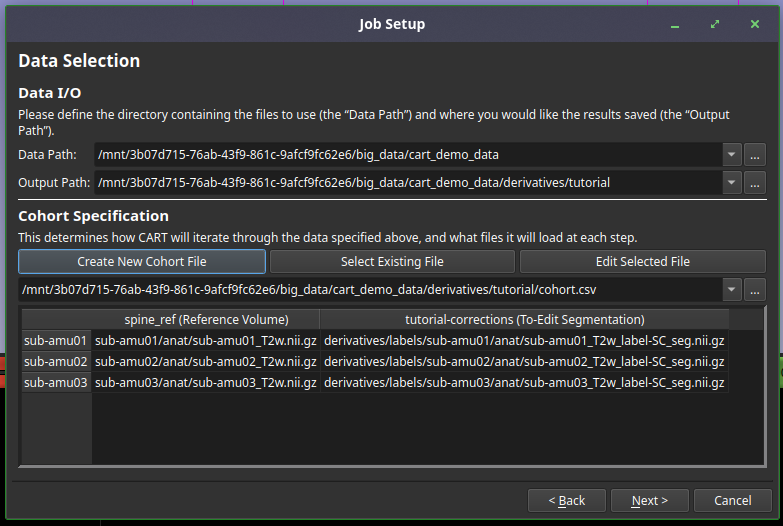

> You can re-use cohort files you've already created in other jobs; simply select their `.csv` using the "Select Existing File" button, and save yourself the hassle!

Now, onto the final step!

### Task Configuration

All that's left is Task-specific configuration; each Task will have its own set of options here. In the case of the Segmentation Task, we get the following:

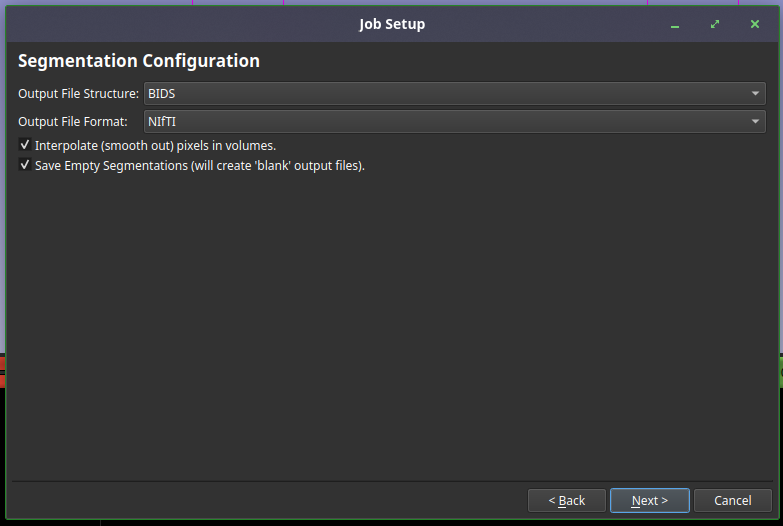

For now, we'll leave the settings as default; we can always come back to this later! Click "Next", and then "Finish"; CART should automatically start the Job using the settings you specified!

## The Result

Given you did everything right, Slicer should look something like this now:

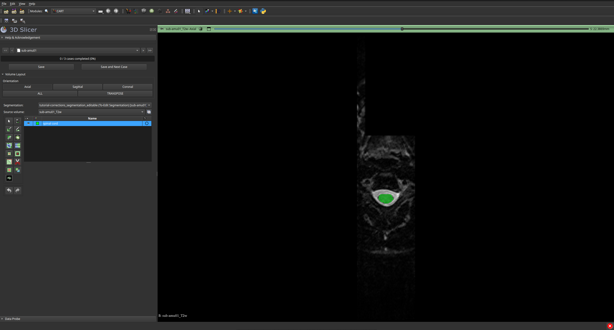

Notice the following:

* CART has recognized there are 3 cases yet to be completed
* Slicer has only loaded the files we requested for the first case (`sub-amu01`)
* The segmentation is loaded as an overlay, in the color you specified, and named as requested

We'll continue to demonstrate CART's utilities in the [next section](./running_a_job.md).
