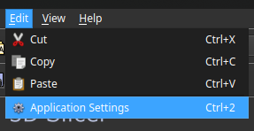
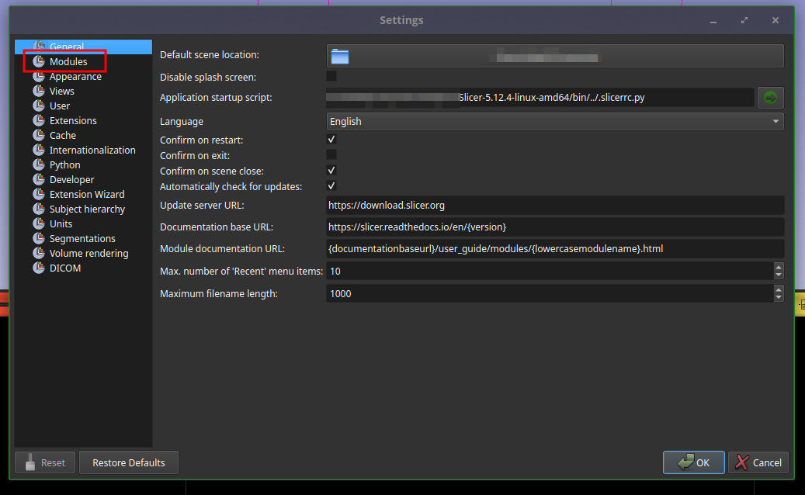
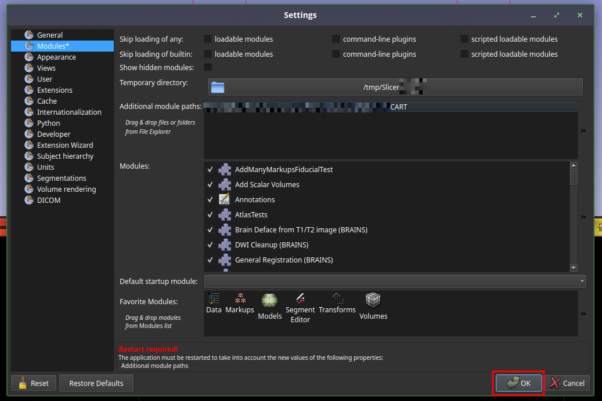
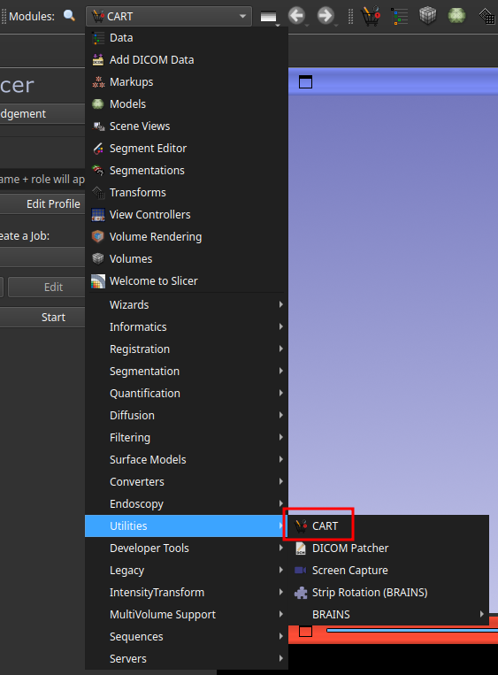
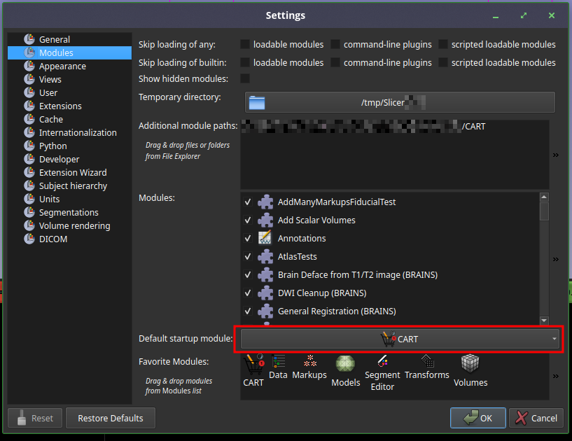
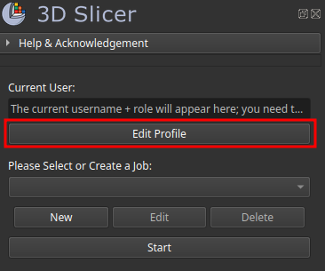
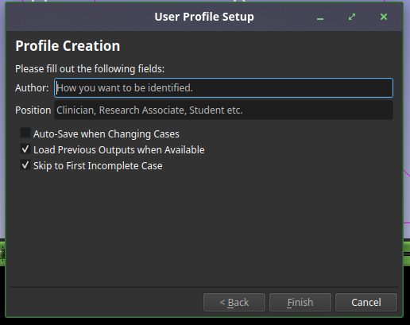

# Installing CART

Following this tutorial will show you how to install CART and set up your user profile within it.

## Prerequisites

Please ensure you have downloaded the following for your specific operating system before beginning:

- 3D Slicer version 5.8 or above (tested up to version 5.12):
  - Download the latest version [here](https://download.slicer.org/).
- A copy of CART:
  - Recommended: the [latest release](https://github.com/neuropoly/slicer-cart/releases/latest).
  - Cutting Edge: the [developer ZIP archive](https://github.com/neuropoly/slicer-cart/archive/refs/heads/main.zip)

Both should be unzipped in a place you can easily find.

## Installing CART

1. Locate your (unzipped) CART directory, then the `CART/` directory within it. This should contain a `CART.py` file
2. Start Slicer and wait for it to finish loading
3. In Slicer, go to `Edit` > `Application Settings`: 

4. In the resulting popup, select `Modules` from the left sidebar:

5. Drag-and-drop the `CART.py` file onto to the "Additional Module Paths" panel
6. Confirm the registration by selecting "OK" on the bottom right:

7. Restart Slicer (it should prompt you to do so immediately).

CART should now appear as one of the modules available to Slicer, under the "Utilities" section. Select it to start CART!

### [Optional] Setting CART as your Default Module

If you are only using Slicer with CART, following these instructions will ensure that Slicer automatically starts CART when initially booted. This will save you needing to select CART each time Slicer starts up.

1. Start Slicer
2. Go to `Edit` > `Application Settings`

3. In the "settings" popup, select `Modules` from the left sidebar

4. Under "Default startup module", Select `Utilities` > `CART`. Confirm with "Ok".

## Creating Your Profile

In CART, your profile serves two main purposes. First, it provides some identifying information that can be used to "mark" the outputs CART produces as being your own. Second, it holds configuration options specific to your preferences on how CART should be used, independent of what task you're running and how it was given to you.

To create your profile (or modify it, if you have already done so), click the "Edit Profile" button:

A dialogue like the following should appear:

Fill it out and toggle the configuration settings to your liking, then confirm with "Finish". Your profile should now be created (or updated, if it already exists)!

Once done, you can move onto [getting started with your first job]().
