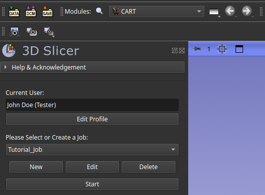
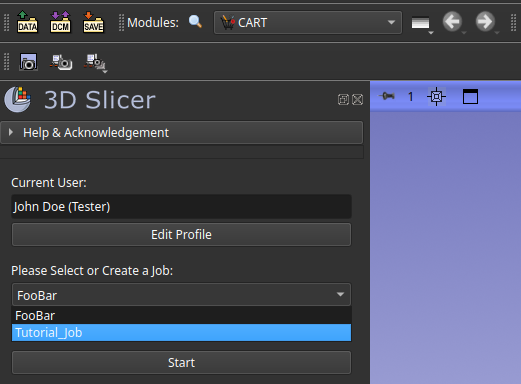
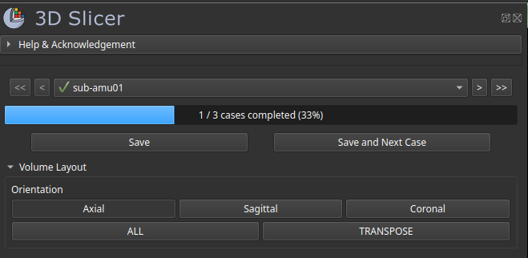
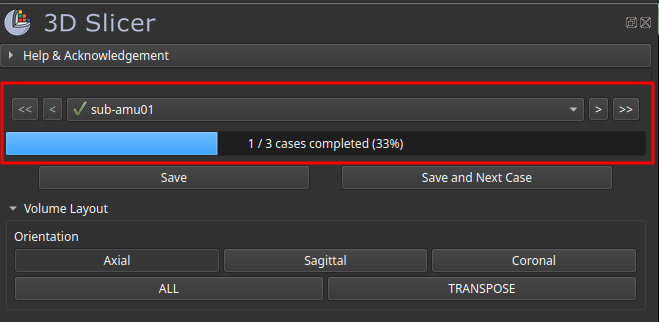
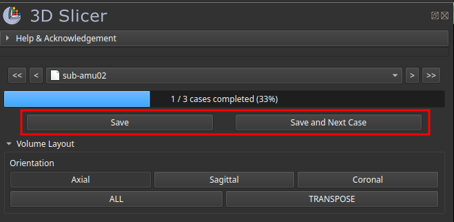
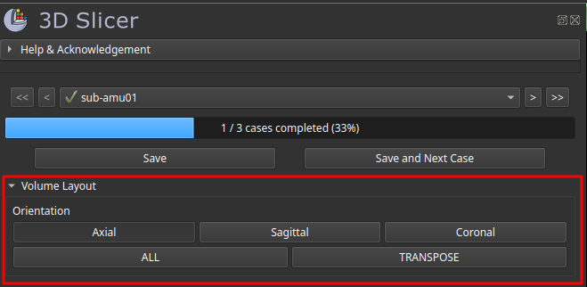

# Running a Job

This tutorial serves to step through the case iteration capabilities of CART, using the job created in the prior tutorial (or your own custom Job, if you have one).

{: .highlight }
CART is lossless by design; unless you explicitly set the Job's output directory to be the same as the input directory (and the output file names happen to align) the original inputs used by CART during the Task are not modified or deleted. Feel free to experiment!

## Prerequisites

* Have a working installation of Slicer v5.8 or newer (tested up to v5.12)
* A copy of CART that has been [installed in Slicer](./installation.md) with a user profile.
* A copy of the example dataset (available [here]()), unzipped and in a location you know.
* You have either followed our [previous tutorial](), or created another Job yourself, and have restarted Slicer.

## Selecting Our Job

Upon rebooting Slicer (and, if need be, initializing CART again), you should be greeted with the following GUI:

If the name of the Job you want to run is already selected in the dropdown menu, we're ready to begin! If not, you can select it from the dropdown like so:

Once you've got the Job you wanted to be selected, click "Start" to start it again!

## Universal CART Options

Regardless of the Task you selected for your job, the following header should appear:

Starting from the top down, these provide the following functionality:

### The Iteration Panel

This panel controls how CART will iterate through the cases you specified in the Job's Cohort file. From right to left (you'll see why this is backwards in a second), the buttons are as follows:

* `>>`: Jump forward to the next case that has not been completed yet.
* `>`: Move to the next case, even if it was completed already.
* "Jump-to" Dropdown: Selecting a case from this drop-down will automatically jump to it.
* `<`: Return to the previous case, even if it was completed already.
* `<<`: Jump to the latest prior case which has yet to be completed.

Note that the icon next to the subject name in the central dropdown will change depending on the status of that case, as follows:

* A white sheet of paper indicates that the Job's Task has not been run on this case yet, and no output yet exists.
* A green checkmark indicates the Job's Task has already been run successfully, and valid output exists.
* A red 'X' indicates the Job tried to run its Task on the case, but could not save the results for some reason.
* A yellow warning sign indicates an error occurred while CART tried to initialize the case, and was aborted.

For the latter two cases, you should check Slicer's logs (and the task's output log, if available) to try and diagnose the problem.

{: .important }
If you checked "Auto-Save When Changing Cases" when creating your profile, CART will automatically request that the Task save the current case's contents, even if no changes have been made!

Try selecting another case from the dropdown; CART should automatically load the files specified in the Cohort file for that case, and hide/unload the files that were presented previously!

### Saving

The two buttons placed underneath do exactly what they say; the left button will request the Task to save its current contents (even if no changes were made), while the one on the right will do the same, but then attempt to iterate to the next case specified in the Cohort file.

If you followed our previous tutorial, modify the Segmentation of the current case in some manner and click "Save". Its text should briefly change to "Saved!", the progress bar should update, and the icon next to the case should become a green check mark! An updated segmentation file should also appear in the output directory you specified during Job creation, along with a sidecar denoting that you made the changes and at what time they were made.

{: .note }
If you are using the Job we created in the previous tutorial, you may have noticed that the input files already had sidecar files. This is common in many data formats, and as a result most CART tasks are smart enough to copy them (with its own updates) rather than generating them from scratch!

### The Orientation Panel

At last, we come to the Orientation panel. Here you can designate which image orientations are shown (being "Axial", "Sagittal", and/or "Coronal"); clicking "ALL" will enable all orientations simultaneously. "TRANSPOSE", in contrast, will "flip" the orientations along the diagonal; instead of being left-to-right, they will be top-to-bottom

{: .note }
If you specified multiple imaging volumes in your job, they will be displayed side-by-side along the _opposite_ axis the orientations are. That is, if the orientations are displayed top-to-bottom, the volumes will be displayed left-to-right (in load order).

